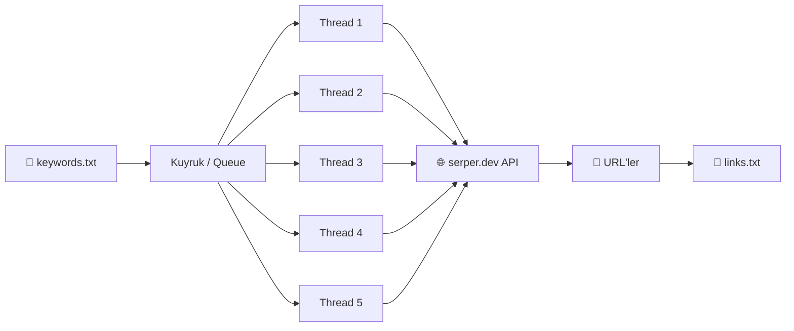

<div align="center">

```
 _     ____  _       ____  ____  ____  ____  ____  _____ ____ 
/ \ /\/  __\/ \     / ___\/   _\/  __\/  _ \/  __\/  __//  __\
| | |||  \/|| |     |    \|  /  |  \/|| / \||  \/||  \  |  \/|
| \_/||    /| |_/\  \___ ||  \__|    /| |-|||  __/|  /_ |    /
\____/\_/\_\\____/  \____/\____/\_/\_\\_/ \|\_/   \____\\_/\_\
```

# 🔎 URL Scraper

**Anahtar kelime listenden Google sonuçlarını toplayıp tek bir dosyaya kaydeden hızlı ve çok iş parçacıklı (multi-threaded) CLI aracı.**
*A fast, multi-threaded CLI tool that turns a keyword list into a clean list of Google result URLs.*


</div>

---

## 📖 İçindekiler

- [Nedir?](#-nedir)
- [Özellikler](#-özellikler)
- [Nasıl Çalışır?](#-nasıl-çalışır)
- [Kurulum](#-kurulum)
- [API Anahtarı](#-api-anahtarı)
- [Kullanım](#-kullanım)
- [Örnek Çıktı](#-örnek-çıktı)
- [Dikkat Edilmesi Gerekenler](#-dikkat-edilmesi-gerekenler)
- [English Summary](#-english-summary)
- [Destek](#-destek)

---

## 🚀 Nedir?

**URL Scraper**, içinde anahtar kelimelerin bulunduğu bir `.txt` dosyasını okuyup her kelime için Google'da arama yapan ve çıkan sonuçların linklerini `links.txt` dosyasına kaydeden bir Python aracıdır.

Aramalar [serper.dev](https://serper.dev) API'si üzerinden yapılır; yani tarayıcı otomasyonu, captcha veya engellenme derdi yoktur. Aracı çalıştırır, kelimeni verirsin, linkler hazır olur.

## ✨ Özellikler

- ⚡ **Çok iş parçacıklı**: 5 thread ile kelimeleri paralel arar
- 🌍 **Ülkeye göre arama**: ISO ülke koduyla (`tr`, `us`, `de`...) o ülkenin sonuçlarını getirir
- 🎯 **Hedef link sayısı**: Toplam kaç link istediğini sen belirlersin, sayıya ulaşınca durur
- 🔒 **Thread-safe sayaç**: Lock kullanıldığı için linkler çakışmadan, doğru sayıda yazılır
- 🎨 **Renkli terminal arayüzü**: `colorama` ile şık ve okunaklı çıktı
- 📝 **Canlı ilerleme**: Her link bulundukça `[3/50] https://...` şeklinde ekrana yazılır
- 🛡️ **Girdi kontrolü**: Hatalı dosya adı, ülke kodu veya sayı girişini yakalar

## ⚙️ Nasıl Çalışır?



1. Kelime dosyası okunur ve her satır bir **kuyruğa** eklenir.
2. 5 worker thread kuyruktan kelime alıp serper.dev API'sine istek atar.
3. Her kelime için gelen organik (organic) sonuçların linkleri alınır.
4. Linkler `links.txt` dosyasına yazılır, hedef sayıya ulaşılınca işlem biter.

## 📦 Kurulum

**Gereksinimler:** Python 3.8+ ve bir [serper.dev](https://serper.dev) API anahtarı

```bash
# Projeyi klonla
git clone https://github.com/umutermisfersan/REPO-ADI.git
cd REPO-ADI

# Gerekli kütüphaneyi yükle
pip install colorama
```

> `REPO-ADI` kısmını kendi repo adınla değiştir.

## 🔑 API Anahtarı

1. [serper.dev](https://serper.dev) adresine üye ol ve ücretsiz API anahtarını al.
2. `main.py` dosyasını aç ve şu satırı bul:

```python
api_key = 'API_ANAHTARIN_BURAYA'
```

3. Kendi anahtarını tırnakların içine yapıştır.

> ⚠️ **Anahtarını asla herkese açık bir repoya yükleme!** Kendi anahtarınla paylaşılan kodu başkaları kullanıp kredini tüketebilir.

## 🕹️ Kullanım

**1)** Proje klasörüne `.txt` uzantılı bir kelime dosyası oluştur. Her satıra **bir anahtar kelime** yaz:

```text
python tutorial
best vpn 2025
ücretsiz film sitesi
```

**2)** Programı çalıştır:

```bash
python main.py
```

**3)** Sorulan 3 bilgiyi gir:

| Soru | Ne yazılmalı? | Örnek |
|------|---------------|-------|
| `Keyword file path` | Dosya adı, **uzantısız** | `keywords` |
| `Country (ISO Format)` | 2 harfli ülke kodu | `tr` |
| `Amount` | Toplam kaç link istediğin (sadece sayı) | `100` |

**4)** İşlem bitince linkler aynı klasördeki **`links.txt`** dosyasında olur. Program sonunda GitHub sayfamı açar 😄

## 🖥️ Örnek Çıktı

```text
Keyword file path (without extension) : keywords
File name :  keywords.txt

Country (ISO Format) : tr
Country :  tr

Amount (numbers only) : 30
Amount :  30

[1/30] https://example.com/ornek-sayfa-1
[2/30] https://example.org/ornek-sayfa-2
[3/30] https://example.net/ornek-sayfa-3
...
Amount : 30 saved to links.txt file
```

## ⚠️ Dikkat Edilmesi Gerekenler

- Dosya adı sadece **harf ve rakamdan** oluşmalı (`keywords`, `list1` gibi). Boşluk, `_`, `-` veya klasör yolu içeremez.
- Kelime dosyası programla **aynı klasörde** olmalı ve uzantısı `.txt` olmalı.
- `links.txt` dosyası her çalıştırmada **üzerine yazılmaz, sonuna eklenir** (append). Temiz bir liste için çalıştırmadan önce sil.
- Her kelime için tek istek atılır ve en fazla **10 sonuç** alınır; farklı kelimeler aynı linki döndürürse **tekrar eden linkler** olabilir.
- Her istek serper.dev kredinden düşer. Kelime listen büyükse krediyi göz önünde bulundur.

## 🌐 English Summary

**URL Scraper** reads a `.txt` file of keywords (one per line), searches each of them on Google through the [serper.dev](https://serper.dev) API using 5 worker threads, and saves the resulting URLs into `links.txt` until your target amount is reached.

```bash
pip install colorama
python main.py
```

Then enter: the keyword file name (without extension), a 2-letter ISO country code, and the number of links you want. Don't forget to put your own serper.dev API key in `main.py`.

## 💖 Destek

Projeyi beğendiysen repoya bir ⭐ bırakmayı unutma, çok mutlu eder!

<div align="center">

**Made with ❤️ by [Umut](https://github.com/umutermisfersan)**

[](https://github.com/umutermisfersan)

</div>
